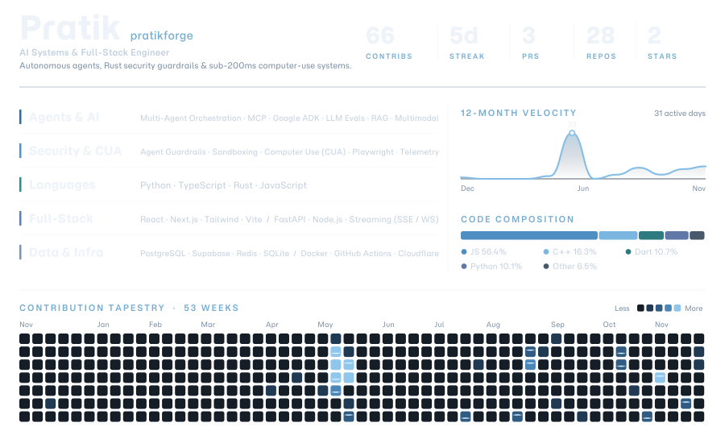

  

  <picture>
    <source media="(prefers-color-scheme: dark)" srcset="./assets/studio-cool-dark.svg" />
    <source media="(prefers-color-scheme: light)" srcset="./assets/studio-cool-light.svg" />
    
  </picture>

  

  <a href="https://github.com/adityayyy">GitHub</a> &nbsp;·&nbsp;
  <a href="https://aditya-info.pages.dev">Website</a>

